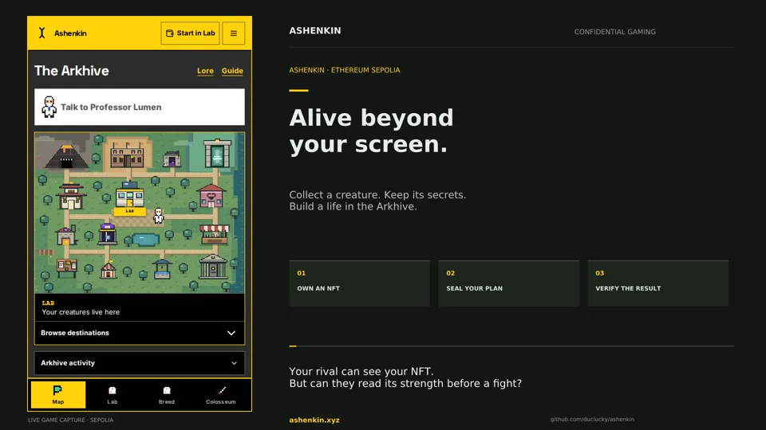

# Ashenkin

Ashenkin is a creature-collecting game on Ethereum Sepolia. Hatch Xenos, breed new bloodlines, and take a three-move battle plan into the Colosseum. Zama FHEVM lets the contract score encrypted moves, training power, elements, and rolls. A public proof reveals who won each round.

This project is not audited, endorsed or operated by Zama. Use at your own risk.

[](https://github.com/duclucky/ashenkin/actions/workflows/checks.yml)

[Play Ashenkin](https://ashenkin.xyz/) · [Judge mode](https://ashenkin.xyz/#/judge) · [Verify Wild Hunt #1](https://ashenkin.xyz/#/arena/log/1)

[Current game rules and release](docs/current-state.md) · [Five-minute judge walkthrough](docs/judge-walkthrough.md) · [Confidentiality and trust model](docs/confidentiality.md) · [Configuration](docs/configuration.md) · [Tests and Sepolia evidence](docs/verification.md)

## Gameplay video

Three minutes of recorded gameplay, with English AI narration and 26 synchronized English captions. The walkthrough shows onboarding, NFT ownership, private battle plans, a real Sepolia replay, public verification and Living Xenos.

[](https://github.com/duclucky/ashenkin/raw/refs/heads/main/docs/media/ashenkin-gameplay-english-ai.mp4)

[Watch / download the MP4](https://github.com/duclucky/ashenkin/raw/refs/heads/main/docs/media/ashenkin-gameplay-english-ai.mp4) · [English subtitles](docs/media/ashenkin-gameplay-english.srt)

This walkthrough uses a synthetic voice. The [Zama Season 5 rules](https://www.zama.org/post/zama-developer-program-mainnet-season-5-confidential-gaming) require a real-person pitch for the competition submission.

## Play and verify

Follow the [five-minute judge walkthrough](docs/judge-walkthrough.md): sign in with
wallet or email, fund the linked game wallet if needed, mint an NFT, and complete
one three-round Wild Hunt. **Gas → Hatch → Fight → Life** is the first-steps path.
NFT ownership is required for gameplay; public replays and proof checks are open
to guests. Hosted Circle signing reduces wallet prompts, but minting and live
battles still submit Sepolia transactions and consume gas. Ordinary hunts reserve
an opponent per keeper; shared rare sightings are listed separately. A dedicated
interactive sponsor settles public results without waiting for each previous
receipt, while preserving Zama proofs and confirmed-result checks.

For an immediate read-only check, open [Wild Hunt #1](https://ashenkin.xyz/#/arena/log/1),
choose **Verify the rounds → Verify all three rounds**, and compare the three
public KMS results with the settled Sepolia record. No sign-in, signature or new
transaction is needed. Keliakor won rounds 1 and 2 and lost round 3.
[Opening transaction](https://sepolia.etherscan.io/tx/0xdd102d9b3391f71ee5539ab71d9d0324823e5e3c9ccd1446ae05d8440f1aeddd) ·
[Settlement transaction](https://sepolia.etherscan.io/tx/0xab52e10d32f2b05bd0b3b4dc09fd58bd72a47bc869b1f02cddcc90b13c4e9d1e) ·
[Guest proof screenshot](docs/proof-center.png).

## Living Xenos

Your NFTs encounter a daily challenge even while you are offline. Zama randomness chooses the encounter and loot; FHE compares hidden strength, elemental advantage and luck against its difficulty. Only the verified outcome opens. A win adds items to the NFT’s field bag; a loss takes nothing. The server sponsors the trial, and players do not sign or claim each result.

Visit [Living Xenos](https://ashenkin.xyz/#/life) to replay new stories, verify the proof and equip a Trail lantern. The first lantern costs either **3 Ash thread** or **1 Ash thread + 1 Archive fragment**. Materials and cosmetics are backend game items, with no token yield or combat bonus. The map’s new-story reminder clears only after the replay reaches its result.

[Encounter design](docs/living-nft-mvp.md) · [Faucet policy](docs/daily-gas-faucet.md) · [First steps](docs/first-steps.md) · [Item pacing](docs/living-item-balance.md)

## What the protocol protects

| Game system | Encrypted state and public result |
| --- | --- |
| Colosseum | Players seal their plans before scoring. If a defender's plan were public, a challenger could pick a counter for each move. Zama generates the wild plan and a fresh encrypted 0–31 roll per side in each round. Settlement checks the KMS proof and records three winner bits. Plans, rolls, and power stay hidden during scoring. |
| Living encounters | One draw per NFT per UTC day. Encrypted strength, element and luck determine success; only the final encounter and loot code is publicly decryptable. The backend verifies the KMS proof before crediting ordinary items. |
| Lab and Nursery | The Lab generates traits with Zama randomness and breeds from encrypted alleles. Ownership, appearance, and parent IDs are public. The keeper controls genome disclosure. |
| Market | Listed prices are public. cZAMA uses ERC-7984, and sale finalization checks the encrypted payment outcome. |

See the scoring and settlement in [Colosseum](contracts/contracts/ChimeraColosseum.sol), hatching and breeding in [Lab](contracts/contracts/ChimeraLab.sol), and the guest verification flow in [ProofDrawer](frontend/src/chimera/game/ProofDrawer.tsx).

## Sepolia deployment

**All 16 application contracts are source-verified on Etherscan, Sourcify and
Blockscout as of November 19, 2026.** Etherscan returned `Pass - Verified` for each.
Published source, ABI and constructor arguments were checked against the deployed
release. [Verification record and all explorer links](docs/verification-20261119/source-verification.json).
Source verification establishes code correspondence; it is not a security audit.

| Contract | Role | Verified source (Sepolia) |
| --- | --- | --- |
| ChimeraLab | Ashenkin NFT (ASHEN), hatch and breed | [0x233d680fc473C36B0d1c6C32Dc8B23eaEcaC8aF2](https://sepolia.etherscan.io/address/0x233d680fc473C36B0d1c6C32Dc8B23eaEcaC8aF2#code) |
| ChimeraTreasury | Fee pools and payouts | [0x2132C2e0f76382DC58414fBbff7068619009d906](https://sepolia.etherscan.io/address/0x2132C2e0f76382DC58414fBbff7068619009d906#code) |
| ChimeraOracle | Encrypted riddle and jackpot | [0x9c79EBa3B3959C0F2F9d14048704407dB99ddFD8](https://sepolia.etherscan.io/address/0x9c79EBa3B3959C0F2F9d14048704407dB99ddFD8#code) |
| ChimeraArena | Original arena module | [0x6D84bA2BeBBC13f2D5BbF652c340365a0dD857BD](https://sepolia.etherscan.io/address/0x6D84bA2BeBBC13f2D5BbF652c340365a0dD857BD#code) |
| ChimeraMarket | NFT escrow and confidential payment | [0xEd1A5BB249073A404F3b6033c242B10D6529975d](https://sepolia.etherscan.io/address/0xEd1A5BB249073A404F3b6033c242B10D6529975d#code) |
| ChimeraRaid | Shared boss raid | [0xC76cd75830Ab24aE2BD2eC74bA83c8D8A9dd0610](https://sepolia.etherscan.io/address/0xC76cd75830Ab24aE2BD2eC74bA83c8D8A9dd0610#code) |
| ChimeraTraining | XP and encrypted training bonus | [0x90E352a87be05cAd5C69bA353bF2C5fC23969f47](https://sepolia.etherscan.io/address/0x90E352a87be05cAd5C69bA353bF2C5fC23969f47#code) |
| ChimeraColosseum | Current three-round combat | [0xa6fa68c5E4d9dAeF079c197c1f3d45ef7D21B59a](https://sepolia.etherscan.io/address/0xa6fa68c5E4d9dAeF079c197c1f3d45ef7D21B59a#code) |
| ChimeraRelics | Relic draws and equipment | [0x2C68d0ECA760b4c6B470CC283EE2b25DB28d03D9](https://sepolia.etherscan.io/address/0x2C68d0ECA760b4c6B470CC283EE2b25DB28d03D9#code) |
| ChimeraExpeditions | Expeditions and loot | [0x9173f61880c927dd1D691ad713e4Eb68f71ab6dd](https://sepolia.etherscan.io/address/0x9173f61880c927dd1D691ad713e4Eb68f71ab6dd#code) |
| ChimeraQuests | Quest progress and rewards | [0x65af84C702d4CE512d0215e0738f4a4CE693FDA5](https://sepolia.etherscan.io/address/0x65af84C702d4CE512d0215e0738f4a4CE693FDA5#code) |
| ChimeraRaffle | Raffle rounds | [0x1a1a62018Af484B8C3390EDAC7c7f63A8bB22BcD](https://sepolia.etherscan.io/address/0x1a1a62018Af484B8C3390EDAC7c7f63A8bB22BcD#code) |
| ChimeraAscension | Voluntary NFT retirement | [0xd2E86Fb170dd2aEf71C4FA1f43c4615A0Ef82aBD](https://sepolia.etherscan.io/address/0xd2E86Fb170dd2aEf71C4FA1f43c4615A0Ef82aBD#code) |
| ChimeraSeason | Season standings and prizes | [0x547c1282C900456d2E398256dCad1254BF5A1d11](https://sepolia.etherscan.io/address/0x547c1282C900456d2E398256dCad1254BF5A1d11#code) |
| ChimeraDepths | Private dungeon choices | [0xdc87d1a2B997ecaB5f985C4e594Af28236c42d70](https://sepolia.etherscan.io/address/0xdc87d1a2B997ecaB5f985C4e594Af28236c42d70#code) |
| AshenkinEncounters | Sponsored daily Living Xenos trials | [0xf2aAf9a3dc7b1a58013117f4712ee6214D8F73E4](https://sepolia.etherscan.io/address/0xf2aAf9a3dc7b1a58013117f4712ee6214D8F73E4#code) |

The internal `Chimera*` identifiers are retained for deployment/ABI compatibility;
the game and NFT collection are Ashenkin. cZAMA is an external test ERC-7984 token
at [0xf2D628d2598aF4eAF94CB76a437Ff86CA78FfbFB](https://sepolia.etherscan.io/address/0xf2D628d2598aF4eAF94CB76a437Ff86CA78FfbFB),
not one of these 16 application contracts and not a redeemable game-income promise.

[Core addresses and ABIs](frontend/src/chimera/contracts.ashenkin.json) ·
[Core deployment receipts](contracts/deployments-ashenkin/sepolia.json) ·
[All 16 creation transactions](docs/verification-20261119/source-verification.json) ·
[NFT #1 metadata](https://ashenkin.xyz/api/ashenkin-nft/1).

## Run from a clone

Install Node.js 22 or later, npm, and Bun 1.4.0. Run from the repository root.

```sh
bun install --cwd frontend --frozen-lockfile
bun install --cwd backend --frozen-lockfile
npm --prefix frontend run build
npm --prefix backend run demo
```

Open [http://127.0.0.1:4173](http://127.0.0.1:4173/). Express serves the built app, NFT API, and FHE WebAssembly files. The app reads Sepolia over public RPC and uses the Zama testnet relayer. The standalone app can connect an external wallet; hosted wallet/email login additionally requires server-only Circle and email configuration. Use the safe [environment examples and configuration guide](docs/configuration.md) to configure those values outside Git. The guest proof check uses public reads. Source builds, tests and services for the hosted project run on its VPS.

For development, run `npm --prefix backend run dev` and `npm --prefix frontend run dev` in separate terminals. Vite serves the game at [http://127.0.0.1:5173](http://127.0.0.1:5173/) and proxies the API to port 3001.

## Test

```sh
npm --prefix frontend run lint
npm --prefix frontend run type-check
node scripts/check-doc-links.js
bun test --isolate --cwd frontend tests
node --test backend/lib/*.test.js
npm --prefix contracts ci
npm --prefix contracts test
```

The Solidity suite uses the Hardhat FHEVM mock. The [Season of Masks test](contracts/test/SeasonOfMasks.ts) exercises hatching, breeding, battle settlement, and a sale. To check the live deployment and NFT URI from the command line, run:

```sh
node backend/scripts/check-demo-v2.js --release https://ashenkin.xyz 1 --require-uri
```

## Evidence and limits

[Verification summary](docs/verification.md) distinguishes local FHEVM mock tests
from actual Sepolia receipts, public KMS verification and authenticated privacy
checks. The repo includes [full game QA](docs/qa-2026-11-18.md) and
[reward/ACL QA](docs/qa-rewards-2026-11-18.md). An organically rare title has not
been successfully claimed on production; its success branch is fixture-tested.

Practice and story choices are browser/backend gameplay, not Zama computations.
The hosted operator controls Circle wallet signing and ordinary inventories.
Sponsor availability affects offline encounters. See the
[trust boundaries](docs/confidentiality.md#hosted-wallet-custody-and-operator-powers)
before treating the hosted wallet as private from its operator. This is a Sepolia
MVP, not an audited mainnet game or a promise of token yield.

The owner reports that the competition submission is complete. The
[submission preparation record](docs/submission.md) retains the original checklist;
it is separate from reproducible repository and chain verification.

The contract workspace derives from Zama's FHEVM Hardhat template and retains its
[BSD-3-Clause-Clear license and attribution](contracts/LICENSE). Third-party
libraries retain their own licenses; the template is not authored by Ashenkin.
