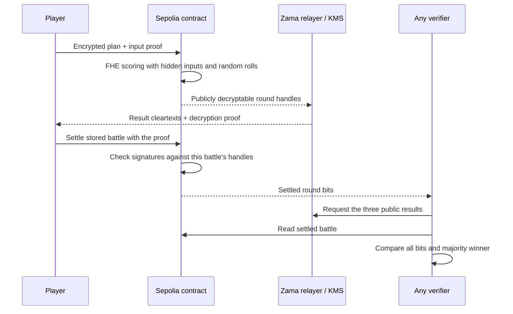

# Confidentiality, fairness and trust boundaries

Ashenkin uses FHE where publishing the input changes how the game can be played.
The public deployment is Ethereum Sepolia (chain ID 11155111). Ordinary story
choices, practice and cosmetic crafting do not claim to be FHE computations.

## Why concealment changes the game

A Colosseum defender commits three moves before a challenger chooses theirs.
If the plan were public, the challenger could select the counter to each move.
FHE lets the contract combine both plans, hidden strength and fresh random rolls
without opening those inputs. The result of each round becomes public. This
preserves the information game; it does not guarantee a win against stronger NFTs.
[Executable counter-plan test](../contracts/test/SeasonOfMasks.ts).

## Data visibility

| System | Public | Authorized private reads / encrypted computation |
| --- | --- | --- |
| Lab | NFT owner, appearance, parents, generation, public level, certification state | Recessive alleles, element and battle profile; owner reads element and sequenced loci. Certification deliberately makes the genome publicly readable. |
| Colosseum | Participants, NFT IDs, timestamps, settlement and three winner bits | Sealed move plans, combat strength, encrypted stakes and fresh round rolls. The keeper can read their own plan; Wild Hunt grants its hunter read access to the wild plan after the opening transaction has already fixed scoring. |
| Training / Relics | Level, XP, equipment IDs; published appraisal when chosen | Random training bonus and relic power; encrypted fee-payment outcome is proved for completion. |
| Living encounters | NFT/holder snapshot, day, outcome handle; publicly decryptable final encounter/loot code | Hidden strength, element, luck and comparison with challenge difficulty. Backend bags and crafting are ordinary server data. |
| Market | Listing, price, NFT transfer, deliberately published badge | ERC-7984 balances and confidential payment; finalization verifies the payment result. |
| Oracle / Raffle | Rules, round deadlines and published finalized outcomes | Oracle answer while open, private hints, raffle tickets and pre-draw state; finalization opens the permitted result. |

Encrypted is not the same as permanently unknowable. An authorized owner can
choose to disclose values. Public outputs, repeated matches and known rules may
also permit statistical inference about hidden power. No resistance to every
inference attack is claimed. Browser-local playbooks are plaintext on the owner's
device, not encrypted by Zama and not protected from malicious browser code.

## Computation and randomness

- [Lab](../contracts/contracts/ChimeraLab.sol) uses `FHE.rand*` for genesis traits
  and encrypted inheritance/mutation. Visible phenotype traits become public;
  hidden loci remain subject to ACL permissions.
- [Colosseum](../contracts/contracts/ChimeraColosseum.sol) imports a plan with an
  input proof bound to the contract and sender. Wild plans use encrypted random
  values. [Combat](../contracts/contracts/ChimeraCombat.sol) scores each side with
  an independent encrypted 0–31 roll and move/element bonuses.
- [Encounters](../contracts/contracts/AshenkinEncounters.sol) generates encrypted
  entropy onchain. It selects encounter, difficulty, luck and loot, compares the
  NFT's hidden battle profile, and opens only the packed outcome. There is at
  most one draw per NFT per UTC day, restricted to the day's population snapshot.

These are Zama FHE random operations inside contract execution, not backend RNG
or browser rolls. Some categorical choices use modulo reduction and have the
probabilities implied by the code; no perfectly uniform distribution is asserted
where modulo reduction introduces a small bias. Local practice is explicitly a
browser simulation with no rewards and no blockchain verification.

## Result verification

The settlement checks the KMS proof for the exact handles stored for that battle,
then records the winner and applies transfers. Anyone can submit a valid public
settlement; a configured sponsor is optional. [Guest verification](https://ashenkin.xyz/#/arena/log/1)
repeats the public result comparison without a wallet or new transaction. This
frontend check does not independently prove every roll; it relies on Zama's
protocol and the settlement contract's accepted proof.

Living loot uses a different path: the backend decrypts the public outcome, calls
the encounter contract's read-only `verify(day,id,cleartexts,proof)`, and credits
its database once per world/day/NFT. Item credit is not an onchain token transfer.
See [worker verification](../backend/lib/life.js),
[proof binding](../backend/lib/life-chain.js) and
[exactly-once inventory storage](../backend/lib/life-store.js).

## Hosted hunt allocation and settlement

Ordinary hunts reserve opponents in the backend; shared rare sightings remain
competitive. Reservations are coordination, not encrypted identity or exclusive
access against direct contract callers. The onchain single-capture rule still
applies. The interactive sponsor uses a separate signer and persistent transaction
journal from the offline worker and faucet. Public proofs and transaction hashes
are exposed; private signer keys and raw signed payloads are not. Sponsoring gas
does not change the contract's KMS checks or the read permissions described above.
[Current flow](current-state.md) · [Transaction design](transaction-design.md).

## Hosted wallet custody and operator powers

Two wallet paths exist: an external wallet in a standalone deployment, and the
hosted game's Circle developer-controlled wallet linked to a verified login.
The latter reduces wallet prompts, but is controlled by the application server.
The API checks sessions, allowlists gameplay calldata and constructs a bounded
EIP-712 Lab-key request rather than signing arbitrary client data.

**The hosted server is trusted.** It can request Circle signatures for its game
wallets, including decryption authorizations. A ciphertext's owner ACL therefore
does not prove secrecy from the operator controlling that owner wallet. Private
keys are managed by Circle; operational API credentials remain server secrets.
For an external wallet, the user's signer authorizes its own decrypt requests.
[Allowed calls and Lab key](../backend/lib/keeper-chain.js),
[session checks](../backend/routes/keeper.js),
[Circle adapter](../backend/lib/circle-keepers.js).

The server also controls email delivery, sessions, inventories/crafting, sponsored
encounter scheduling and faucet availability. Item proofs establish the encounter
outcome, not censorship resistance or a fully trustless inventory. The sponsor
budget may postpone eligible encounters; a new NFT after the population snapshot
waits for a subsequent epoch. Offline loot is neither guaranteed income nor yield.

Contract owners can change certain links, cooldowns, caps and round timing through
explicit admin functions. They do not thereby acquire the ACL permission to read
an Oracle answer. Admin configuration and hosted signing remain material trust
assumptions; production has not undergone an independent security audit.

## Attacks covered and remaining limits

| Check | Evidence |
| --- | --- |
| Forged/cross-NFT outcome and duplicate credit rejected | [Encounter tests](../contracts/test/AshenkinEncounters.ts), [backend tests](../backend/lib/life.test.js) |
| A different wallet cannot read private hints/traits | [Sepolia privacy report](qa-rewards-2026-11-18.md#quyền-riêng-tư-và-chống-nhận-thưởng-sai) |
| Authentication replay, wrong wallet and arbitrary call rejection | [Keeper API tests](../backend/lib/keeper.test.js) |
| Replayed payout/old round proof rejected | [Reward edge tests](../contracts/test/RewardEdgeBranches.ts) |
| Lost acknowledgement is recovered without blind resend | [Reconciliation tests](../backend/lib/keeper-reconcile.test.js) |

This is an MVP threat model, not a formal audit. Dependence on RPC, relayer/KMS,
Circle, the operator and testnet ETH remains. No Sybil-proof identity guarantee or
mainnet economic sustainability is claimed. [Verification scope](verification.md).
